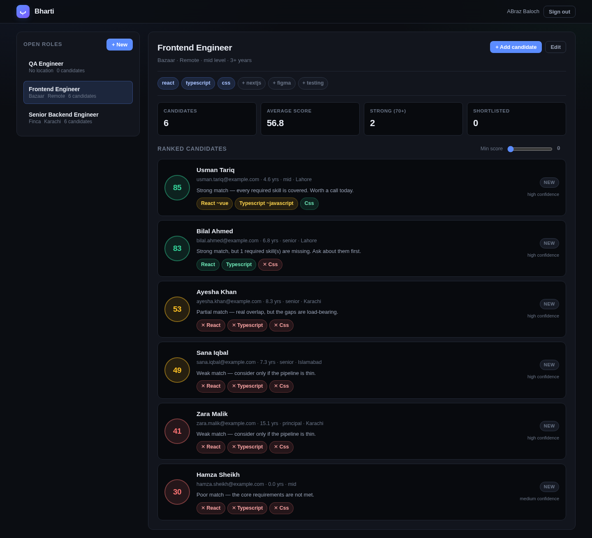
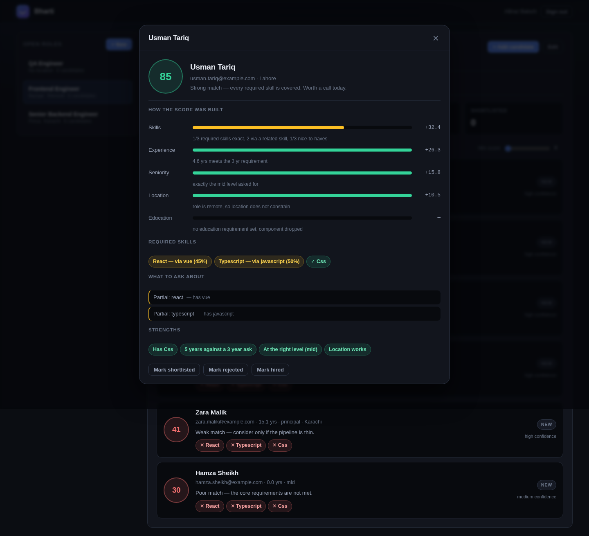
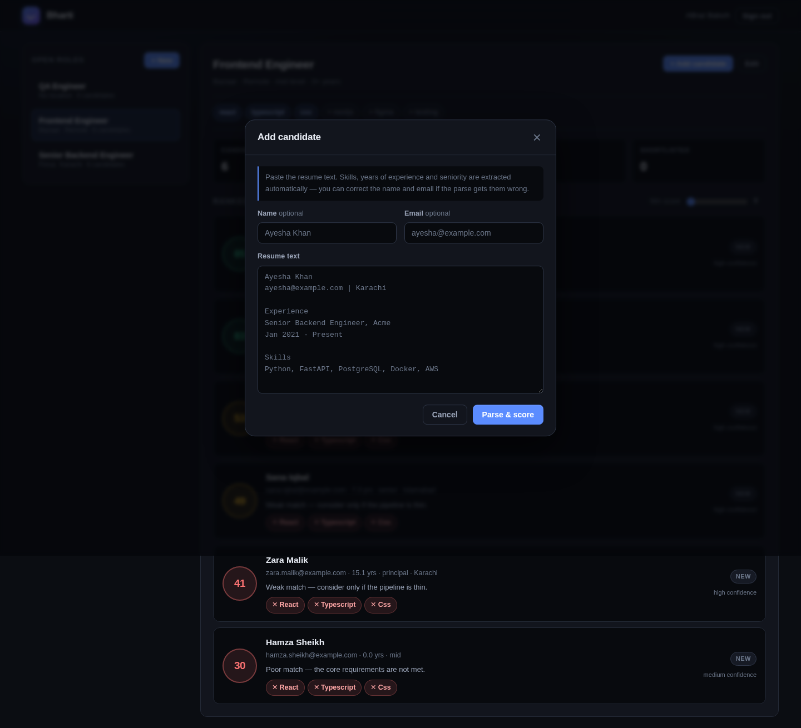
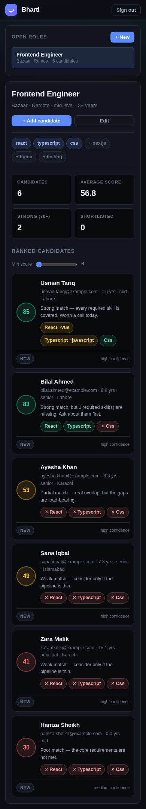

# Bharti — recruitment matching that shows its working

**بھرتی** · *bharti* — Urdu for "recruitment"

[](https://www.python.org/)
[](https://fastapi.tiangolo.com/)
[](#testing)
[](LICENSE)

Every hiring tool gives you a ranked list and asks you to trust it. Bharti gives you the ranked list **and the arithmetic behind every number on it**.

A recruiter who disagrees with a ranking can see which component moved it, by how much, and why — then argue with that component instead of a black box.

---

## The problem

A recruiter gets 200 applications for one role. The ATS scores them and shows a number. Nobody can explain the number, so nobody trusts it, so the recruiter opens the first 20 in submission order and the ranking was decoration.

The failure isn't the ranking. It's that the ranking is **unfalsifiable**. You can't disagree with a score you can't read.

## What Bharti does differently

**Every score is a sum of five named components**, each with its own sentence:

```
skills      0.45  →  3/3 required skills exact, 1/1 nice-to-haves
experience  0.25  →  7.6 yrs meets the 5 yr requirement
seniority   0.15  →  exactly the senior level asked for
location    0.10  →  both in Karachi
education   0.05  →  holds a bachelor degree, which is what was asked for
```

**Missing data is not a zero.** A candidate with no location on their resume is not penalised for being in the wrong place — the location component is dropped and the remaining weights are renormalised. Scoring someone down for information you never had is how good candidates get filtered out, and it's the single most important line in the matcher.

**Related skills earn partial credit, never full.** "I know Vue" is worth 0.45 of a React requirement. A test asserts no edge in the graph ever exceeds 0.5, because partial credit that rounds up to full credit is a lie.

**Gaps are named.** The output says which required skills are missing and which are only partially covered, so the recruiter knows what to ask about in the first five minutes of the call.

---

## Features

| | |
|---|---|
| **Explainable scoring** | Five weighted components, each with a human-readable reason and its point contribution |
| **Resume parsing** | Contact details, skills, job titles, education, seniority, and years of experience from pasted text |
| **Skill taxonomy** | 90+ canonical skills with aliases (`reactjs` → `react`, `k8s` → `kubernetes`) and a related-skill graph |
| **Overlap-aware experience** | Concurrent roles count once — two jobs for a year is one year, not two |
| **Gap analysis** | Missing vs. partially-covered required skills, listed separately |
| **Confidence signal** | Says `low` when the score rests on thin data, instead of pretending to be sure |
| **Shortlist workflow** | new / shortlisted / rejected / hired, with live re-scoring when requirements change |
| **JWT auth** | bcrypt hashing, role-based access, per-endpoint rate limits |
| **Responsive UI** | Mobile-first, no build step, works at 390px |

---

## Screenshots

| Ranked shortlist | Score breakdown |
|---|---|
|  |  |

| Add a candidate | Mobile |
|---|---|
|  |  |

---

## Quick start

```bash
git clone https://github.com/mohdabrarbaloch-arch/bharti-recruitment-matcher.git
cd bharti-recruitment-matcher

python -m venv .venv && source .venv/bin/activate
pip install -r requirements.txt

cp .env.example .env
python -c "import secrets; print('SECRET_KEY=' + secrets.token_urlsafe(48))" >> .env

python -m scripts.seed
uvicorn app.main:app --reload
```

Open **http://127.0.0.1:8000** and sign in:

```
email:    abraz@example.com
password: bharti-demo-2026
```

The seed creates two roles and six candidates whose resumes deliberately exercise the parser's awkward cases — overlapping roles, missing dates, inconsistent skill spellings, and one strong match with a single gap.

### With Docker

```bash
export SECRET_KEY=$(python -c "import secrets; print(secrets.token_urlsafe(48))")
docker compose up --build
```

Brings up Postgres 16 and the app together. The app refuses to start without `SECRET_KEY` — a default signing key in a public repo is how sessions get forged.

---

## How the score is built

```
                    ┌──────────────────────────────┐
   resume text ───▶ │  parser.py                   │
                    │  contact · skills · dates    │
                    └──────────────┬───────────────┘
                                   │ ParsedResume
                                   ▼
   job requirements ──▶ ┌──────────────────────────┐
                        │  matcher.py              │
                        │  ┌────────────────────┐  │
                        │  │ skills      0.45   │  │
                        │  │ experience  0.25   │  │
                        │  │ seniority   0.15   │  │
                        │  │ location    0.10   │  │
                        │  │ education   0.05   │  │
                        │  └────────────────────┘  │
                        │  renormalise over the    │
                        │  components that applied │
                        └──────────────┬───────────┘
                                       │ MatchResult
                                       ▼
                        total · verdict · confidence
                        components[] · gaps[] · strengths[]
```

The engine is **pure functions over dataclasses** — no database, no I/O, no config. That's why the physics is testable in microseconds and why the API layer can't leak into it.

Full design notes, including the reasoning behind each weight, are in [ARCHITECTURE.md](ARCHITECTURE.md).

---

## API

| Method | Endpoint | What it does |
|---|---|---|
| `GET` | `/api/health` | Health check (unauthenticated) |
| `POST` | `/api/auth/register` | Create an account, returns a token |
| `POST` | `/api/auth/login` | Sign in |
| `GET` | `/api/auth/me` | Current user |
| `POST` | `/api/jobs` | Create a role |
| `GET` | `/api/jobs` | List your roles |
| `PATCH` | `/api/jobs/{id}` | Update a role (re-scores its candidates) |
| `DELETE` | `/api/jobs/{id}` | Delete a role |
| `GET` | `/api/jobs/{id}/ranked` | **Ranked candidates with full breakdowns** |
| `POST` | `/api/jobs/{id}/candidates` | Add a candidate by pasting a resume |
| `PATCH` | `/api/jobs/{id}/candidates/{cid}` | Change shortlist status |
| `GET` | `/api/skills` | Skill taxonomy for autocomplete |
| `GET` | `/api/admin/stats` | Platform stats (admin only) |

Interactive docs at **`/api/docs`**. Full reference in [docs/API.md](docs/API.md).

### Status codes

| Code | When |
|---|---|
| `401` | No token, bad token, wrong password |
| `403` | Authenticated but not permitted (non-admin on `/api/admin/stats`) |
| `404` | Unknown job — **also returned for another user's job**, because a 403 would confirm it exists |
| `409` | Duplicate email, or a candidate already in that job's pipeline |
| `422` | Validation failure, or a resume with no extractable email |
| `429` | Rate limit exceeded, with `Retry-After` |

---

## Testing

```bash
pytest -q          # 127 tests, ~9s, no network, no database
ruff check .       # lint
ruff format --check .
```

The suite covers the taxonomy, the parser's date arithmetic, the matcher's renormalisation behaviour, and the full API surface including the status-code matrix.

---

## Known limitations

Honest list, because a README that only lists strengths is marketing:

- **No live deployment.** This needs a persistent database and a long-running process; Vercel's serverless model gives neither. `docker compose up --build` is the intended path.
- **No migrations.** Tables are created on startup via `create_all()`. Fine for this scope, not for schema evolution — Alembic is the answer.
- **Rate limiting is per-process.** N workers means N times the limit. Redis is the fix.
- **The parser is regex-based.** It handles the common resume shapes well and degrades honestly (it emits warnings rather than guessing), but it is not an LLM extractor and will miss unusual layouts.
- **CSP allows `unsafe-inline` for styles.** A deliberate trade to avoid a build step; noted in `main.py`.
- **Skills are stored as JSON arrays**, not a join table. The matcher works on whole lists and never queries "who has React" across the table, so a join table would add complexity for a query nobody runs.

---

## License

MIT — see [LICENSE](LICENSE).

Built by [ABraz Baloch](https://github.com/mohdabrarbaloch-arch) as Day 29 of a 30-day AI engineering challenge.
